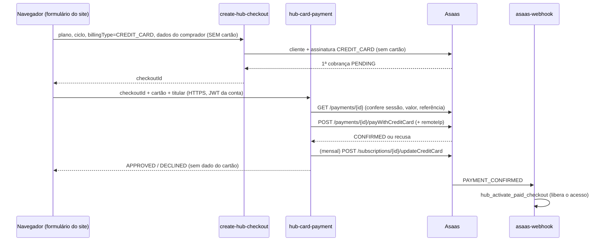

# Pagamento com cartão no nosso formulário (Hub e Wolfie)

Decisão do Vinícius em 22/11/2026: checkout transparente pelo Asaas da Wise Wolf, com o cartão
digitado no nosso formulário ("nosso asaas mesmo, assumimos o risco"). Modelo: o checkout do
MotoFix (`lib/cartao.ts`, `server/anualParcelado.ts`). Este documento é a base de um futuro
autoatendimento PCI (SAQ). **Hoje o cartão passa pelo nosso servidor: o escopo PCI é o de
quem recebe o PAN (SAQ D), não o de quem usa campo seguro hospedado.**

## Situação da conta Asaas (medida em 22/11/2026)

| Recurso | Estado | Como foi medido |
|---|---|---|
| Tokenização (`/creditCard/tokenize`) | **desligada** ("forbidden… gerente de contas") | chamada com cartão inválido |
| Cobrança com cartão (`/payments` + `creditCard`) | liberada | cartão vencido → `invalid_creditCard` (expirado) |
| Assinatura com cartão (`/subscriptions` + `creditCard`) | liberada | idem |

Decisão: seguir **sem tokenização**. Mensal = assinatura no cartão (o Asaas guarda o cartão e
cobra os próximos meses). Anual e pacotes = cobrança única. Troca de cartão =
`POST /subscriptions/{id}/updateCreditCard` (sem cobrar). Renovação do anual = aviso antes de
vencer e novo pagamento (cartão no formulário ou PIX). Nenhum `creditCardToken` é guardado.

## Fluxo de dados do cartão

- O número, a validade e o CVV existem só: no formulário (memória do navegador, nunca
  `localStorage`/`sessionStorage`), no corpo HTTPS para `hub-card-payment` e no corpo HTTPS
  para o Asaas. **Nada disso é gravado** em banco, arquivo, log, Sentry, auditoria ou resposta.
- `create-hub-checkout` grava o payload em auditoria; por isso ele **recusa** corpo com
  `card`, `creditCard`, `creditCardHolderInfo`, `cvv`/`ccv` (`CARD_DATA_NOT_ACCEPTED_HERE`).
- Depois da tentativa, `hub_card_payment_attempts` guarda só: sessão, usuário, **hash HMAC do IP**,
  resultado, motivo curto, **4 últimos dígitos e bandeira devolvidos pelo Asaas**.

## Proteções

| Proteção | Onde |
|---|---|
| Função dedicada, a única que recebe cartão | `supabase/functions/hub-card-payment` |
| Validação antes do Asaas (Luhn, validade, CVV, CPF/CNPJ, CEP, telefone); erro nunca ecoa o valor | `hub-card-payment/core.ts` (+ testes) |
| Só a pessoa logada que abriu a cobrança paga; cobrança conferida no Asaas (referência `hub:<id>`, valor, CREDIT_CARD, PENDING) | `hub-card-payment/index.ts` |
| `remoteIp` do comprador (nunca o do servidor): 1º item do `X-Forwarded-For` — o Caddy não confia no cabeçalho do cliente e grava o IP real; o Kong acrescenta o dele | `core.ts` `buyerIp` |
| Anti card testing: conta exige login; por conta 5 tentativas/h e 10/dia; por IP 8/h; 3 recusas por cobrança encerram o cartão nela; uma tentativa por vez | `hub_card_payment_gate` (migration `20261122210000`) |
| Cerca de capacidade do Asaas antes de cada escrita | `revalidateAsaasMutationCapability` |
| Logs: só id da sessão, status HTTP e nome do erro | `console.*` da função |
| Kong: access log `combined` (linha da requisição, sem corpo); Caddy do `api.`: sem access log; runtime de edge: só `console` | conferido na VPS em 22/11/2026 |
| Formulário sem scripts de terceiros: Pixel/GTM não rodam no componente do cartão; CSP estrita na página do checkout | site institucional (`components/solucoes/SolutionCheckout.tsx`) |
| Parcelamento | não oferecido (anual é à vista) |

## Pendências conhecidas

- **Renovação do anual:** o Asaas gera a cobrança do ano seguinte sem cartão; falta o aviso
  nosso antes do vencimento (primeira renovação em 11/2027).
- **Tokenização:** se o gerente do Asaas ligar, dá para trocar `updateCreditCard` por token.
- **Escopo PCI:** com o cartão passando pelo servidor, a conformidade formal é SAQ D
  (questionário + varredura ASV trimestral). Nada disso foi feito ainda.
